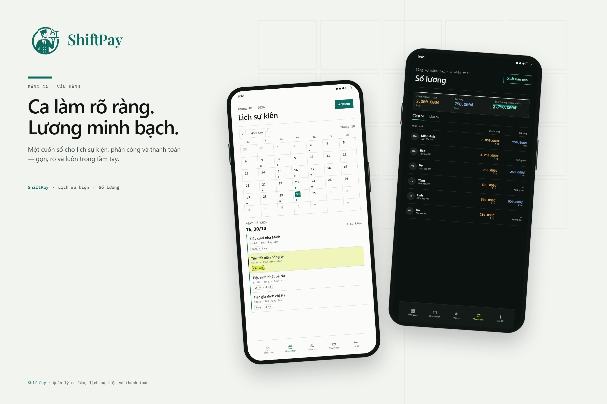
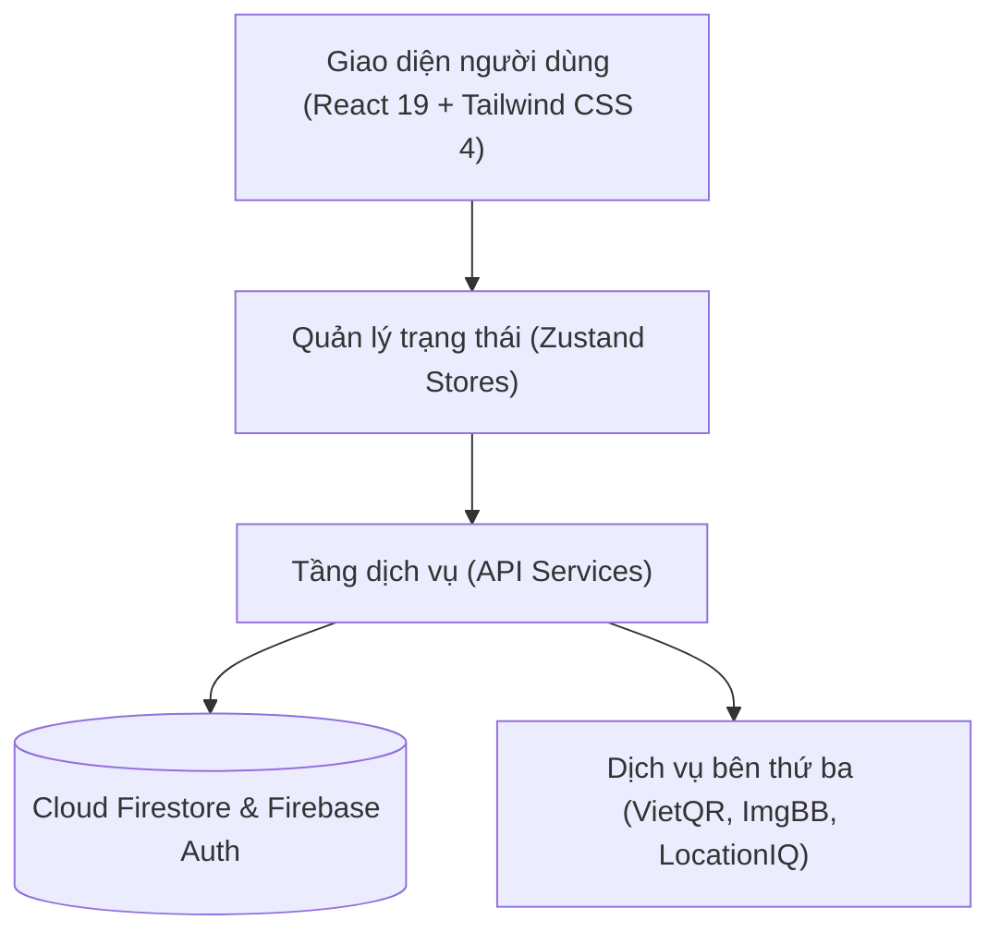

<div align="center">
  
  <h1>ShiftPay</h1>
  <p><strong>Ca làm rõ ràng. Lương minh bạch.</strong></p>
  <p>Hệ thống quản lý lịch sự kiện, phân công ca làm và thanh toán thù lao cho nhân viên sự kiện.</p>

  <p>
    
    
    
    
    
    
    
  </p>
</div>

---

## Mục lục

- [Giới thiệu](#giới-thiệu)
- [Tính năng chính](#tính-năng-chính)
- [Quy trình hoạt động](#quy-trình-hoạt-động)
- [Đối tượng sử dụng](#đối-tượng-sử-dụng)
- [Kiến trúc](#kiến-trúc)
- [Công nghệ](#công-nghệ)
- [Cài đặt](#cài-đặt)
- [Cấu hình môi trường](#cấu-hình-môi-trường)
- [Lệnh phát triển và đóng gói](#lệnh-phát-triển-và-đóng-gói)
- [Cấu trúc thư mục](#cấu-trúc-thư-mục)
- [Đóng góp](#đóng-góp)
- [Giấy phép](#giấy-phép)

## Giới thiệu

Quy trình quản lý nhân viên sự kiện thường bị phân tán giữa bảng tính và tin nhắn nhóm, gây khó khăn trong việc theo dõi lịch sự kiện, phân công ca làm và đối soát thù lao.

ShiftPay hợp nhất toàn bộ quy trình vận hành:

- **Lịch sự kiện trực quan:** Theo dõi toàn bộ sự kiện theo tháng và các ca làm cần bố trí nhân sự.
- **Phân công ca làm:** Gán nhân viên vào từng ca làm (sáng hoặc chiều) và cảnh báo khi sự kiện còn thiếu người.
- **Sổ lương & ứng lương:** Theo dõi thù lao chưa trả, ghi nhận các khoản ứng lương và quyết toán thù lao minh bạch.
- **Thanh toán VietQR:** Tạo mã chuyển khoản thanh toán thù lao trực tiếp theo từng nhân viên.



## Tính năng chính

### Lịch sự kiện

Hiển thị toàn bộ sự kiện trong tháng dưới dạng lưới lịch. Chọn ngày để xem chi tiết giờ tổ chức, địa điểm và số ca làm. Đánh dấu trạng thái ca làm chưa đủ người để tránh bỏ sót.

### Phân công ca làm

Gán nhân viên vào từng ca làm (sáng hoặc chiều), kiểm tra lịch sử làm việc và cập nhật danh sách phân công nhanh chóng.

### Sổ lương

Tổng hợp chi tiết số ca làm, các khoản đã ứng lương, phụ phí và số tiền thực nhận của từng nhân viên.

### Thanh toán qua mã VietQR

Tạo mã VietQR đúng số tiền cần thanh toán dựa trên thông tin tài khoản ngân hàng của nhân viên. Lưu lại lịch sử giao dịch để đối soát sau.

### Quản lý địa điểm và nhân viên

Lưu trữ địa chỉ, tọa độ và ghi chú đánh giá độ thuận tiện của từng địa điểm tổ chức. Hồ sơ nhân viên lưu ảnh đại diện, số điện thoại và thông tin tài khoản nhận thù lao.

### Hoạt động dạng ứng dụng (PWA)

Cài đặt ứng dụng lên màn hình chính, hỗ trợ giao diện sáng/tối theo hệ thống. Khi mất kết nối mạng, ứng dụng duy trì shell giao diện và hiển thị thông báo trạng thái ngoại tuyến.

## Quy trình hoạt động

1. **Tạo sự kiện:** Chọn ngày, giờ, địa điểm tổ chức và mức thù lao cơ bản cho mỗi ca làm.
2. **Xếp ca làm:** Chọn ca sáng hoặc chiều, gán nhân viên vào ca và đối chiếu danh sách phân công.
3. **Quyết toán:** Rà soát thù lao chưa trả, xử lý ứng lương hoặc thanh toán qua VietQR, sau đó xuất file CSV khi cần.

## Đối tượng sử dụng

- Nhà hàng và đơn vị tổ chức tiệc cần xếp ca làm theo từng sự kiện.
- Đội ngũ vận hành cần quản lý nhân viên, địa điểm và thù lao trong cùng một hệ thống.
- Quản lý cần đối soát chính xác thù lao chưa trả, ứng lương và quyết toán theo thời gian thực.

## Kiến trúc

ShiftPay được xây dựng theo kiến trúc modular frontend kết hợp service-based layer. Tầng giao diện đọc trạng thái từ Zustand stores và gọi các action thông qua API services.



Các tầng thành phần:

1. **Giao diện (UI):** React 19, Tailwind CSS 4, Radix UI primitives, Framer Motion; kiểm thực dữ liệu đầu vào với Zod.
2. **Trạng thái (Store):** Zustand quản lý dữ liệu ứng dụng (`appDataStore`), phiên đăng nhập (`authStore`), phiên sổ lương (`ledgerSession`) và theme (`themeStore`).
3. **Dịch vụ (API Services):** Đóng gói tương tác Firestore và API bên ngoài, xử lý transaction và batch ghi dữ liệu.
4. **Dịch vụ tích hợp:** Firebase (xác thực và cơ sở dữ liệu), VietQR (mã chuyển khoản), ImgBB (lưu trữ ảnh đại diện), LocationIQ (autocomplete địa chỉ và bản đồ tĩnh).

## Công nghệ

React 19 · TypeScript 5.8 · Vite 6.2 · Firebase 12.6 · Tailwind CSS 4.3 · Radix UI · Zustand 5.0 · Framer Motion 12.23.

## Cài đặt

Yêu cầu môi trường:

- Node.js `>= 20`
- npm `>= 10`
- Git

```bash
git clone https://github.com/dexter826/at_shiftpay.git
cd at_shiftpay
npm install
```

## Cấu hình môi trường

Tạo tệp `.env` từ mẫu `.env.example` và cấu hình các giá trị tương ứng:

```bash
cp .env.example .env
```

```env
# Firebase (bắt buộc)
VITE_FIREBASE_API_KEY=
VITE_FIREBASE_AUTH_DOMAIN=
VITE_FIREBASE_PROJECT_ID=
VITE_FIREBASE_STORAGE_BUCKET=
VITE_FIREBASE_MESSAGING_SENDER_ID=
VITE_FIREBASE_APP_ID=

# ImgBB (bắt buộc khi upload ảnh đại diện)
VITE_IMGBB_API_KEY=

# LocationIQ (tùy chọn)
VITE_LOCATIONIQ_API_KEY=
```

| Biến môi trường | Yêu cầu | Mô tả |
| :--- | :---: | :--- |
| `VITE_FIREBASE_API_KEY` | Bắt buộc | Khóa API của dự án Firebase. |
| `VITE_FIREBASE_AUTH_DOMAIN` | Bắt buộc | Domain xác thực Firebase Authentication. |
| `VITE_FIREBASE_PROJECT_ID` | Bắt buộc | Mã định danh dự án (Project ID) Firebase. |
| `VITE_FIREBASE_STORAGE_BUCKET` | Bắt buộc | Bucket lưu trữ Firebase Storage. |
| `VITE_FIREBASE_MESSAGING_SENDER_ID` | Bắt buộc | Sender ID dịch vụ Firebase Cloud Messaging. |
| `VITE_FIREBASE_APP_ID` | Bắt buộc | App ID ứng dụng web trên Firebase. |
| `VITE_IMGBB_API_KEY` | Bắt buộc khi upload ảnh | Khóa API ImgBB để tải lên ảnh đại diện nhân viên. |
| `VITE_LOCATIONIQ_API_KEY` | Tùy chọn | Khóa LocationIQ phục vụ gợi ý địa chỉ và bản đồ tĩnh (dùng placeholder khi bỏ trống). |

> [!WARNING]
> Tuyệt đối không commit tệp `.env` chứa thông tin cấu hình thực tế lên kho mã nguồn.

## Lệnh phát triển và đóng gói

Các lệnh được định nghĩa trong `package.json`:

```bash
# Khởi chạy máy chủ phát triển (mặc định cổng 3000)
npm run dev

# Kiểm tra chất lượng mã nguồn với ESLint
npm run lint

# Tự động sửa lỗi cú pháp với ESLint
npm run lint:fix

# Kiểm tra kiểu tĩnh với TypeScript compiler
npx tsc --noEmit

# Kiểm tra định dạng mã nguồn với Prettier
npm run format:check

# Tự động định dạng lại mã nguồn
npm run format

# Đóng gói sản phẩm cho môi trường production
npm run build

# Xem trước bản đóng gói production cục bộ
npm run preview
```

Máy chủ phát triển lắng nghe tại cổng `3000` (theo cấu hình trong `vite.config.ts`).

## Cấu trúc thư mục

```text
at_shiftpay/
├── src/
│   ├── app/             # App shell, router, ErrorBoundary và các trang màn hình (routes)
│   ├── components/      # Giao diện người dùng dùng chung, layout và UI primitives
│   ├── features/        # Các module tính năng: auth, calendar, dashboard, employee, location, payroll, settings
│   ├── dev/             # Màn hình Gallery phục vụ phát triển thành phần UI
│   ├── lib/             # Firebase SDK, API services, cấu hình chuyển động (motion) và tiện ích
│   ├── stores/          # Zustand stores: appData, auth, ledgerSession, theme
│   ├── types/           # Định nghĩa TypeScript interface và type dùng chung
│   ├── utils/           # Hàm tiện ích: định dạng (format), tính toán sổ lương (payrollMath), kiểm thực dữ liệu
│   ├── index.css        # Thiết lập Tailwind CSS tokens và phong cách giao diện
│   └── index.tsx        # Điểm khởi chạy ứng dụng (entry point)
├── public/              # Tài nguyên tĩnh: logo nhận diện, icon, PWA manifest và service worker
├── docs/                # Tài liệu kỹ thuật và hình ảnh mô tả
├── DESIGN.md            # Đặc tả hệ thống thiết kế (Design System)
├── GLOSSARY.md          # Thuật ngữ nghiệp vụ chuẩn của dự án
├── firebase.json        # Cấu hình dịch vụ Firebase
├── firestore.indexes.json
├── firestore.rules
├── .env.example
└── vite.config.ts
```

> Thư mục `dist/` và `node_modules/` được sinh tự động trong quá trình cài đặt hoặc build và được bỏ qua theo `.gitignore`.

## Đóng góp

1. Tạo nhánh mới từ nhánh chính cho mỗi tính năng hoặc bản sửa lỗi.
2. Kiểm tra chất lượng mã nguồn trước khi tạo Pull Request:
   ```bash
   npm run lint
   npx tsc --noEmit
   npm run format:check
   npm run build
   ```
3. Đảm bảo toàn bộ lệnh kiểm tra hoàn tất không có lỗi.

## Giấy phép

Dự án sử dụng nội bộ, không phân phối cho mục đích thương mại.

---

<div align="center">
  Phát triển bởi <a href="https://github.com/dexter826">MOB</a>
</div>
